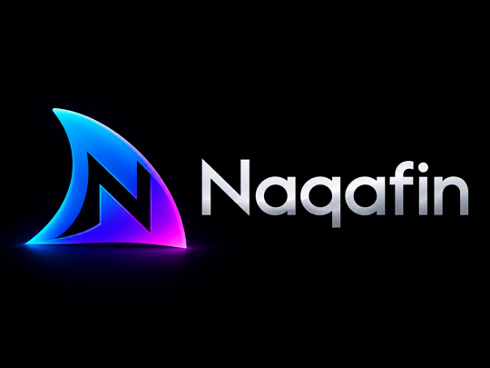

  

  <h1>Naqafin</h1>
  
  
  
  
  
  

  <b>Naqafin</b> is a fork of Swiftfin for the <a href="https://github.com/jellyfin/jellyfin">Jellyfin</a> media server, adapted for Naqadata's Naqafin product family.

## Fork Notice

This repository is based on the official [Jellyfin Swiftfin](https://github.com/jellyfin/Swiftfin) Apple client. Jellyfin and Swiftfin names, documentation references, and API terminology may still appear where they identify the upstream project or Jellyfin server platform.

## Status

Naqafin is currently being brought to parity with the existing Roku implementation. App Store and TestFlight links will be added when Naqafin Apple releases are available.

## 📖 Documentation

The inherited Swiftfin documentation remains useful while this fork is being adapted:

- [Library Support](Documentation/libraries.md)
- [Media Playback](Documentation/players.md)
- [OS Version Support](Documentation/version.md)
- [Contributing](Documentation/contributing.md)

## ⚙️ Development

Set your Apple developer team in `XcodeConfig/DevelopmentTeam.xcconfig` if needed. The shared bundle identifier for this fork is `com.naqadata.naqafin`.
